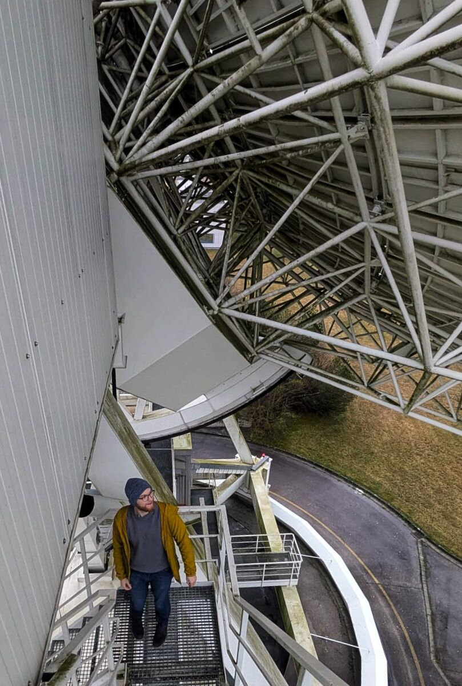
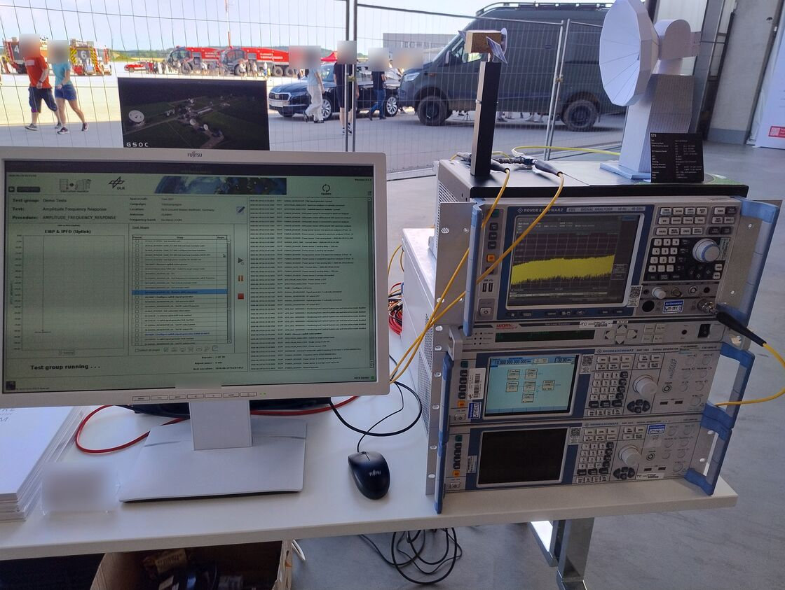

{alt="Julian on a metal stairway below the reflector of a large antenna dish, looking up." width=420 height=623}

## Short bio

I live in Bavaria, Germany.
I'm studying EE in Munich and I work at the German Aerospace Center (DLR).
Outside of work and university I'm an amateur radio operator and avid reader.

## Experience

I did an internship at the DLR and now work there part-time. My work involves RF measurement development and automation, RF compatibility testing and related tasks.

## Education

Bachelor's degree in electrical engineering and information technology, Hochschule München. Currently studying.

## Amateur radio

My current and first callsign is DD4JS and CW is the mode I enjoy most.
I'm a member of the DARC at OV C28.
You can find me on [QRZ.com](https://www.qrz.com/db/DD4JS).

{alt="Rack of RF measurement instruments with a spectrum analyser on top and signal generators below, next to a monitor showing test software. A paper model of an antenna stands on the rack." width=560 height=422}
